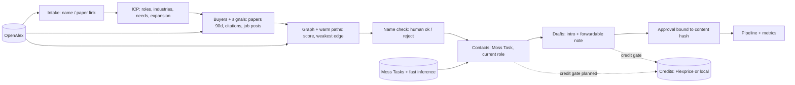

# DeepBridge: system design

Status legend: **built** = in the code today; **planned** = designed, not yet in the code; **simulated** = demo data, labelled as such.

## 1. Overview

DeepBridge helps a deep-tech founder find buyers and the warmest evidenced path to them. A founder signs up with a name or paper link. The system reads their public papers (OpenAlex), infers an ideal customer profile (ICP), ranks buyer companies by public signals, and shows a graph of people linking the founder to those buyers. Every claim on screen points to an Evidence record (source URL, verbatim quote, date). For a chosen path, a Moss browser task checks the bridge person's current role, and an LLM drafts an intro request plus a forwardable note. A human must approve the exact text before anything counts as approved. **Nothing is ever sent**; the demo stops at drafts and approvals. Credits gate the paid steps and a pipeline dashboard tracks stages and who acted (agent or human).

The demo case is cached (one founder and company, 24 Nov 2026). Any other founder can be tried through intake; ICP and drafts are then generated live and cached.

Stack: FastAPI service (`service/`), typed contract in `contracts/types.ts` mirrored by `service/app/models.py`, Next.js web app (`web/`), JSON fixtures in `fixtures/` loaded into an in-memory store at start.

## 2. Graph ontology

**Nodes.** `Person` (founder, bridge candidates, buyer contacts), `Org` (company, university, lab, government, other; `is_buyer`, `buyer_score` 0-100). Papers, filings, job posts and web pages are not nodes: they are `Evidence` attached to nodes and edges, which keeps the graph small and every claim checkable.

**Evidence** (every claim needs one): `source_url` (a human can open it), `quote` (verbatim text, or `field: value` copied from an API response), `source_date` (date of the fact, e.g. paper date), `observed_at` (when we fetched it), `kind` (paper, affiliation, job_post, filing, grant, web, board_page).

**Edges.** Each has a date, evidence ids, `confidence` 0-1, a `name_check` state and a short label.

| Edge type | Meaning | Warmth weight (planned scoring) |
|---|---|---|
| DUAL_AFFILIATION | one paper lists the person at a university and a company | 1.0 |
| LAB_MATE | co-authored while both were at the founder's lab or university | 0.9 |
| ADVISOR_LAB | reached through the founder's PhD advisor's co-authors | 0.7 |
| CO_AUTHORED | any shared paper | 0.6 |
| CITES | the person's paper cites the founder's paper | 0.4 |
| TOPIC_ALIGNED | publishes on the same topic, no shared paper | 0.3 |
| AFFILIATED_AT | person to org, as of a date | structural |
| BOARD | shared board or advisor listing | structural |
| PERSONAL | from the owner's own network, labelled | structural |

Labels state only what the evidence shows, e.g. "co-authored 2017 (MIT)". A co-author link never reads "knows"; draft validation rejects "know(s)".

**"As of" semantics.** `Person.org_id` is the affiliation on a dated publication (`affiliation_asof`), not a claim about the current job. Current role comes only from a separate contact lookup, which carries its own `asof` date and source quote.

**Name check.** Author names collide. Each edge starts `unchecked`. A human sets `ok` or `rejected` via `POST /name-check` (**built**). Automatic homonym flagging (affiliation mismatch lowers confidence below 0.5) and the effect of `rejected` on path scores are **planned**.

Today the demo graph and paths are served from fixtures (`/graph`, `/paths`). Computing them from cached OpenAlex data for any founder is **planned**.

## 3. Query logic

**Intake (built).** OpenAlex, keyless, throttled (about 5 requests/s), 20 s deadline, raw responses cached on disk. A DOI or work id resolves the paper and matches the author by name; an author id is read directly; a plain name searches authors (exact normalized name match preferred, then highest cited count). The founder's 5 most-cited works become Evidence, and topics are the most frequent OpenAlex topics across them.

**ICP (built).** One LLM call over those works and the persona text. Output is JSON of buyer roles, industries, needs and expansion segments, each citing evidence ids. All items are framed as hypotheses, not verified demand.

**Buyer signals (built, `lanes/jakob/signals.py`).** For each candidate company (other than the founder's own), using the company's OpenAlex institution id:
- Recent papers: works from the institution in the last 90 days whose title or abstract matches the founder's topic terms (`institutions.id`, `from_publication_date`, `title_and_abstract.search`).
- Citations: distinct works from the institution that cite any founder work (`cites:` filter, up to 100 ids per OR group, paginated). If the search is unavailable, individually checked known citing works give an explicit lower bound.
- Job posts: public job-board APIs (Greenhouse, Ashby, Lever supported; one verified board configured) filtered by topic terms in the title. Listing time is not a publication date, so the date stays null.
- Score = `min(40, 4 x papers_90d) + min(35, 5 x citing_papers) + min(25, 5 x job_posts)`. This ranks interest; it is not purchase intent. A failed source adds zero, never an invented claim. Results are written to `fixtures/buyers_computed.json` and replayed by `/buyers`.

**Contacts (built).** A Moss Task (browser environment, `moss-fast`, 120 s and 0.5 USD limit) receives the person's name and their dated paper evidence and must return current role, current org, an as-of date and profile URLs each with a verbatim quote, against a JSON schema. The task is rejected unless it completed with verification passed. Moss is never asked for emails or phones. An email, if any, comes from an optional email-finder call (Hunter) on the employer domain, and is marked verified or guessed. Results are cached in `fixtures/contacts.json`.

**Path scoring (planned; fixture scores today).** Score = edge warmth (table above) x recency decay x name-check factor, scaled 0-100. The `weakest_edge_id` marks the lowest-warmth hop so the UI shows where the path is thinnest. Fixture scores are demo ranking heuristics, not measured relationship strength.

## 4. Reasoning loops and guards

1. **Evidence-only generation, then validation.** ICP and drafts get only the evidence records tied to the founder, the path edges and one buyer signal. Output is parsed and validated in code. ICP items without in-scope evidence ids are dropped, and the ICP fails if a group ends up empty. A draft is rejected if it cites unknown evidence, exceeds 110 words, uses "know(s)", lacks the forwardable blurb, or has the wrong kinds for the path (bridge: intro + note; no bridge: direct fallback). Rejected output is never shown.
2. **Human name check** on each edge before a path is trusted.
3. **Hash-bound approval.** `content_hash = sha256(subject + "\n" + body)`. `POST /approve` must carry the current hash; a mismatch returns **409**. Editing an approved draft sets it to `stale` and changes the hash, so it must be approved again. Approvals are logged with actor and time.
4. **Credit gate.** `POST /drafts` debits 1 credit; at balance 0 it returns **402** and logs a blocked event. Repeat requests for already-generated drafts do not charge again.
5. **Pipeline.** Stages: found, path_checked, draft, approved, intro_asked, intro_made, pilot. Cards cannot move backwards (409). Each move records actor and `agent` or `human`; `/metrics` derives per-stage counts, stage conversion, results by path kind and actions by actor. The seeded pipeline history is **simulated**.
6. **Caching and replay for stage safety.** Raw OpenAlex responses (per URL, per day), ICP (fingerprint of inputs), drafts (hash of grounding context) and contacts are cached. Live calls have timeouts and fall back to the cache or a labelled stub ("Cached affiliation only; not verified").
7. **LLM calls run with tools disabled.** `run_claude()` calls the Claude CLI with an empty tool set, no MCP servers and an empty temp working directory, because prompts include untrusted text (forms, abstracts). Prompts also instruct the model to treat input as data. No paid API key is used.

## 5. Integrations

- **OpenAlex** (built): intake, buyer signals, evidence URLs. Keyless, rate-limited, cached.
- **Moss** (built for contacts, key-gated): Tasks API for current-role and profile checks with verified, schema-bound output and cost limits. Fast inference for a voice-interview intake is **planned**; prospecting through Tasks is **planned**. If the key is missing or the task fails, the contact falls back to the cached result or a stub.
- **Flexprice** (credit gate **built locally**, Flexprice connection **planned**): `/credits` returns balance, events and a `source` field (`flexprice` or `local`). Today the gate runs on a local counter (sample allocation of 5 credits) with the 402 behaviour above. Planned: report `Leads Enriched`, `Outreach Sent` and `Graph Queries Evaluated` as metered events, read the wallet from Flexprice, and keep the local counter as fallback.
- **Band** (multi-agent collaboration with human decision): **planned**; today the agent versus human split shows in pipeline history and draft approval.

Honesty rules: numbers on screen come from code or fixtures; cached or replayed data is labelled; publication affiliations are dated; segments and needs are hypotheses; nothing is sent to real people.
