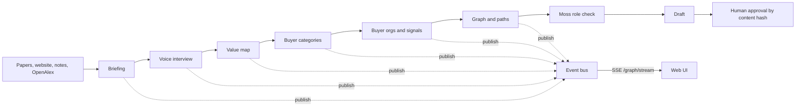

# DeepBridge architecture

Status is stated per part: **built** means it runs on this branch. **Planned** means it does not.

## 1. Overview

A deep-tech founder needs a warm path into the R&D team of a technical buyer. Cold outreach rarely reaches that team. DeepBridge reads the founder's research, interviews the founder by voice, and builds one layered knowledge graph. The graph runs from the founder's value proposition to buyer organisations and to people who could introduce the founder. Every link carries a cited, dated source. A human approves each intro draft. **Nothing is sent.**

The demo case is Hannah Weber of HOPO Therapeutics. The science comes from Rebecca J. Abergel's group at Berkeley Lab. A second case, Lightmatter, replays from fixtures as a smoke test.

## 2. Query logic

**Founder to data (OpenAlex, built).** `lanes/erick/pull.py` takes an OpenAlex author ID. It pulls the founder's works (up to 75), co-author profiles (up to 30), the advisor's works, and works that cite the founder (up to 25). OpenAlex works without a key. `OPENALEX_API_KEY` is optional and is never written into a cache key. Calls are spaced at least 210 ms apart. Each response is stored under `data/cache/erick/raw/`, so the second run needs no network. Routes report cache state in `X-Graph-Data` and `X-Graph-Partial`.

**Buyer discovery (built).** `GET /buyers` ranks organisations from public signals: recent papers on the topic, job posts, and citations of the founder's work. Each signal has evidence. The score is a heuristic. Results are cached per founder. The HOPO buyer list is a committed fixture.

**Contacts (built, key needed for live use).** `GET /contacts/{person_id}` returns the cached result first. A refresh starts a Moss Task that checks the person's current role and public profiles. Moss is not asked for emails or phone numbers. Each claim keeps its source URL and date.

**Replay.** Every stage-critical step reads from cache or fixtures. The stage run needs no keys and no network. Replays are labelled as such.

## 3. Graph ontology

`GET /knowledge-graph` returns three layers.

| Layer | Nodes | Edges |
|---|---|---|
| Core | Founder, papers, value map: feature, benefit, value, problem | `ENABLES` (feature to benefit), `DELIVERS` (benefit to value), `SOLVES` (value to problem) |
| Category | `BuyerCategory`: name, colour, problem set | `FITS` (category to buyer org) |
| Lead | `Org`, `Person` | `LAB_MATE`, `DUAL_AFFILIATION`, `ADVISOR_LAB`, `CO_AUTHORED`, `CITES`, `TOPIC_ALIGNED`, `AFFILIATED_AT` (as of a date) |

A `Path` lists its hops, its weakest edge, and a score. The contract also defines `BOARD` and `PERSONAL` edges. The pull does not produce them.

**Evidence model.** Every claim has an `Evidence` record with `source_url`, `quote`, `source_date` and `observed_at`. A shared paper is "co-authored 2018", never "knows". An affiliation is stated "as of" its source date and does not show current employment. Each edge has `name_check` (`unchecked`, `ok`, `rejected`) so a human can confirm identity. The contract is `contracts/types.ts`, mirrored in `service/app/models.py`.

## 4. Reasoning loop

1. **Briefing.** The service reads papers, the website and notes. It lists what it understood, claims with sources, and gaps. Notion and Google Drive connectors can supply documents.
2. **Voice interview.** A hosted voice app fetches the briefing and posts each turn to `POST /interview/turn`. Founder answers sharpen the value map.
3. **Categories.** Buyer categories group organisations by problem set.
4. **Buyer orgs.** `/buyers` supplies organisations and signals.
5. **Path search.** `paths.py` finds directed, loop-free paths of two or three edges. A path must end at a buyer organisation. A company match ignores a trailing country, so "Bayer (Norway)" in a paper reaches the buyer "Bayer". The match does not apply to universities, labs or government bodies.
6. **Verify.** Moss checks the final hop's current role.
7. **Draft and approval.** A draft is generated, then a human approves it. The approval records a hash of the exact text. Editing the draft makes the approval stale.

**Warmth.** Each edge weight is `warmth(type) × recency × identity × confidence`.

- Warmth by type: `DUAL_AFFILIATION` 1.0, `AFFILIATED_AT` 1.0, `LAB_MATE` 0.9, `ADVISOR_LAB` 0.7, `CO_AUTHORED` 0.6, `CITES` 0.4, `TOPIC_ALIGNED` 0.3.
- Recency: `2^(−years/10)` from the edge date. Without a date it is 0.5.
- Identity (name check): 1.0 if `ok`, 0.65 if `unchecked`, and the edge is dropped if `rejected`.

The path score is `geometric_mean(weights) × √min(weights) × buyer_score`. Buyer score is 0 to 100. A buyer without a score counts as 100. The lowest-weight edge is marked as the weakest. The search keeps the best path for each bridge and buyer pair. It returns at most 50 paths. These scores rank public signals. They do not measure a relationship.

## 5. Live graph events

Lanes call `events.publish(session_id, phase, kind, layer, ...)`. Each event gets a per-session `seq` and a timestamp. Phases are `reading`, `interview`, `discovery` and `paths`. Kinds are `node`, `edge`, `path`, `category` and `status`.

`GET /graph/stream?session_id=…` serves events as server-sent events:

- **Live follow** (`speed` ≤ 1). New events arrive as they are published.
- **Replay** (`speed` > 1, capped at 64). Gaps between events follow the recorded `at` times, clamped to 0.02–2 s. The stream ends with an `end` event.
- **Resume** with `from_seq` or the `Last-Event-ID` header.
- `GET /graph/events` returns the full log.

`data/graph_events/<session>.json` holds recorded logs. `demo-hopo.json` is the canonical log (107 events). It is built from cached data only by `lanes/erick/record_log.py`. It loads when a session has no live events. A Lightmatter fallback log (`demo-lightmatter`) is **planned**; it is not in the repository yet. The web app currently reads `/knowledge-graph`. Animating the graph from this stream is **planned** on the web side.

## 6. Integrations

| Service | Use | Status |
|---|---|---|
| OpenAlex | Papers, authors, citations | Built, keyless, cached |
| Moss Tasks | Role verification for contacts | Built, needs `MOSS_PROJECT_ID`, `MOSS_PROJECT_KEY`; cached results replay |
| Moss inference / voice | Interview question choice and summaries; transcript intake | Built, falls back to a script engine without keys |
| Claude | `llm.run_claude` runs the subscription CLI with tools and MCP off, in an empty directory. Prompts contain untrusted text. | Built |
| Flexprice | `credits.py` has a client for balance and usage events. Without keys, a local counter starts at 5 credits and returns HTTP 402 at zero. | Adapter built. Live use not verified here. |
| Notion, Google Drive | `/connectors/{id}/fetch` reads a page or file | Built, needs `NOTION_TOKEN` or `GDRIVE_SA_FILE` |
| Hosted voice app | Reads `/interview/brief/{id}`, posts to `/interview/turn` | Built on the API side |

## 7. Limits and honesty

- Most demo data is cached or replayed, and says so.
- OpenAlex author matching can confuse people with the same name. `name_check` lets a human confirm or reject an edge. Company affiliations seen only in an author profile get confidence of at most 0.45.
- Pulls are samples with size limits. A rate-limited pull can be partial. The response headers say so.
- Buyer and path scores rank public signals. They do not show purchase intent or relationship strength.
- Seeded pipeline history is simulated.
- Known issues for the event stream are in `service/app/lanes/erick/KNOWN_ISSUES.md`. Examples: a payload field can override `seq`, and a log reload during replay can splice the stream. None is high severity.
- Planned: web animation from the SSE stream, the Lightmatter fallback log, live Flexprice verification.
